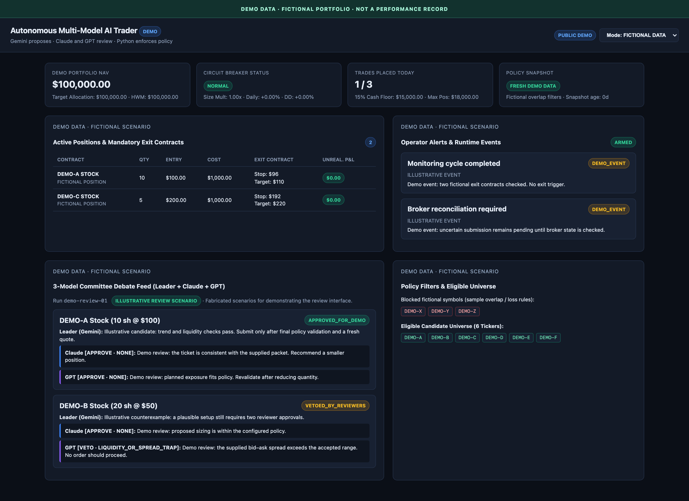
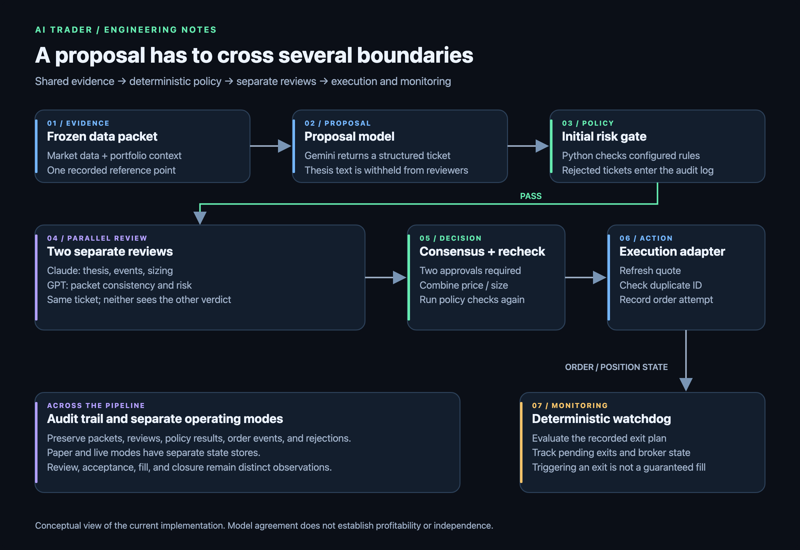
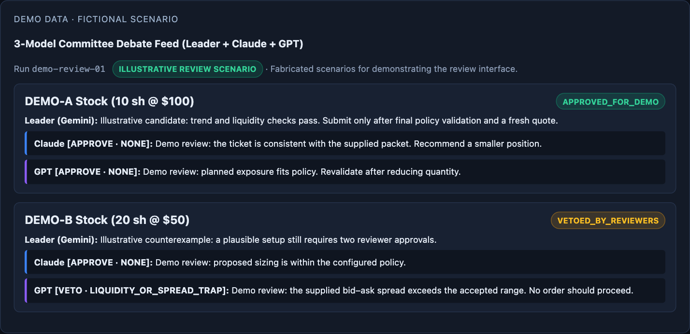
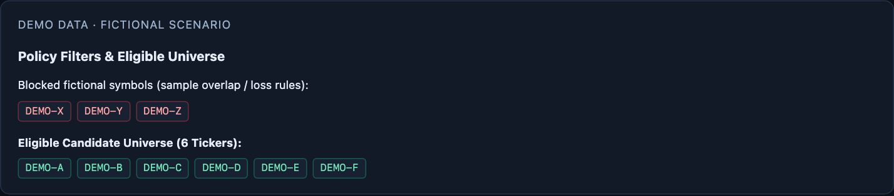
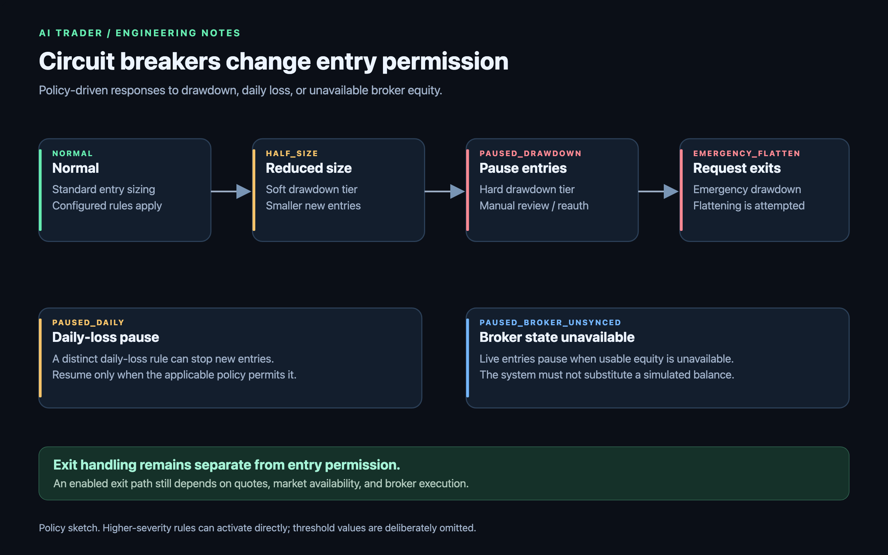
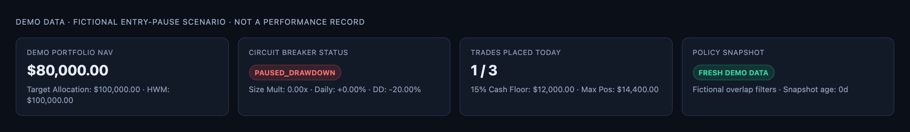
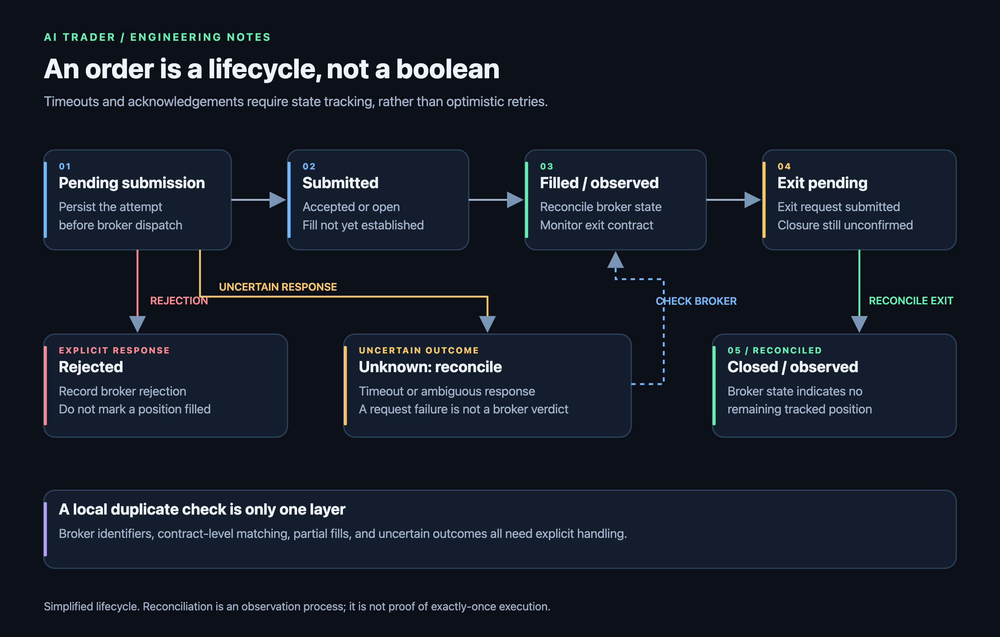
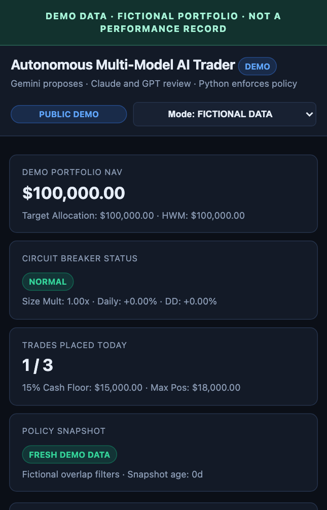

# Building an AI Trader With Deterministic Risk Controls

I built an experimental trading system that uses one model to propose trades, two others to review them, and Python to enforce the rules between those steps.

The interesting engineering problem is deciding what an AI-generated proposal is allowed to do. A convincing explanation cannot override a position limit. Agreement between models cannot make an old quote current. An accepted order cannot be treated as a confirmed fill.

The implementation stays private. This repository documents the architecture and its limitations, without publishing source code, account information, or trading records.

*A public demo rendering of the dashboard. All balances, symbols, positions, events, and review text in these screenshots are fictional. Private labels are replaced and inline explanations are collapsed. These images show the interface, not a performance record or historical model output.*

## The decision pipeline

Each decision cycle starts with a frozen packet of market and portfolio data. It gives the proposer and reviewers a shared reference point and gives the audit log something concrete to preserve.

The pipeline is:

1. Build the market and portfolio snapshot.
2. Ask a proposer for structured trade candidates.
3. Apply deterministic eligibility and risk checks.
4. Send eligible proposals to two reviewers in parallel.
5. Require both reviewers to approve.
6. Recheck the adjusted proposal against the risk rules.
7. Pass the approved ticket to the execution adapter.
8. Track the order and monitor the position separately.

Gemini handles proposal generation, while Claude and GPT handle the two reviews. Their roles are separate from the Python execution path.

*The boundaries matter: a proposal, a policy pass, a reviewer approval, and an execution attempt are different events.*

## Review the ticket, not the sales pitch

Before review, the system removes the proposer's thesis text. Each reviewer receives the proposed ticket, the relevant market data, portfolio context, and the initial risk-check results.

That is an attempt to reduce narrative anchoring: the reviewers should evaluate the trade rather than continue the proposer's argument. They do not receive each other's verdict before returning their own.

The consensus gate requires two approvals. A missing review, timeout, or non-approval blocks the proposal. Reviewers can also recommend a smaller position or a lower purchase limit. Python combines those recommendations and reruns the risk check before execution.

Separate model calls do not establish statistical independence. The reviewers share inputs and can share blind spots. Whether this review structure improves decisions needs to be measured.

*Illustrative review text: one unanimous approval and one veto. The examples are fixtures, not captured model responses.*

## Keep enforceable rules in code

The deterministic gate checks whether a proposal fits the configured trading policy. Its checks include:

- Restricting execution to the designated account.
- Permitting only supported opening trades, with no short positions or multi-leg option spreads.
- Grounding symbols and option contracts in the supplied market packet.
- Applying quote-age, liquidity, option-expiration, and delta requirements.
- Limiting position size, aggregate exposure, concurrent positions, and daily trade count.
- Preserving a configured cash reserve.
- Requiring a structured exit plan and checking stop distance and reward-to-risk assumptions.
- Applying household overlap and tax-related restrictions from a supplied snapshot.

The tax-related checks are policy filters based on the data available to the system. They are not a complete tax determination.

*The interface separates excluded symbols from the candidate universe. The symbols above are invented for this demo.*

The system also tracks drawdown and daily losses. Its circuit-breaker logic can reduce entry size or pause new positions, with manual reauthorization required for certain lock states. Entry restrictions and position-exit handling are separate concerns.

*A policy sketch rather than a recommended trading configuration. Higher-severity rules can activate directly.*

*A different demo scenario: new entries are paused. The sample portfolio value is fictional and does not establish why any real account paused.*

## Submission is not a fill

The execution path checks risk and consensus results, generates a client order identifier, checks the local ledger for duplicates, and refreshes the underlying quote before a live entry. If that quote is unavailable or has moved beyond the configured tolerance, the entry is aborted.

Before sending a live order, it records a pending-submission event. The order lifecycle distinguishes submitted, filled, rejected, and uncertain outcomes that require reconciliation.

Those distinctions matter after a timeout. A failed request does not establish that the broker failed to receive the order. Retrying without checking can create a duplicate.

The implementation includes duplicate checks and broker-position reconciliation, but those mechanisms still need scrutiny. A local client identifier is not proof of broker-enforced exactly-once execution, and position reconciliation needs enough detail to distinguish option contracts and partial fills.

*An uncertain response needs reconciliation. It must not be silently rewritten as either a confirmed fill or a confirmed failure.*

## Exits use a separate monitoring loop

An exit plan should not require another round of model deliberation before the system can act on it.

A separate watchdog evaluates configured stops, profit targets, holding deadlines, and option-expiration rules. It uses deterministic logic to choose exit actions and tracks pending exits until subsequent broker reconciliation indicates the position has closed.

This is polling-based monitoring with external dependencies. A trigger does not guarantee a fill or a particular loss limit. Quote availability, market hours, spreads, gaps, and broker responses still affect execution.

## Preserve the evidence

Paper and live modes use separate state directories. Run records preserve the data packet, proposals, review results, risk decisions, timing, and execution outcomes. Rejected proposals go into a separate log for later analysis.

A dashboard brings together portfolio state, decisions, and operating status. The test suite includes cases for account restrictions, proposal eligibility, circuit breakers, reviewer consensus, duplicate handling, and paper/live state separation. Those tests exercise software behavior; they do not validate a trading strategy's profitability.

*The same demo at a mobile viewport, with summary cards stacked vertically. All values and events remain fictional.*

The next useful evaluation is a comparison: proposer alone, proposer plus deterministic rules, and the full review pipeline. I want to measure the reviewers' incremental value alongside latency, inference cost, rejection rates, and execution quality.

## What this project establishes so far

This is an engineering experiment. I am not presenting a verified return figure, an audited track record, or evidence that multiple models outperform a simpler strategy.

The architecture makes proposals, policy checks, reviews, execution attempts, and observed outcomes separately inspectable. That separation is useful well beyond trading, wherever a model recommends an action and software must decide whether and how to carry it out.
